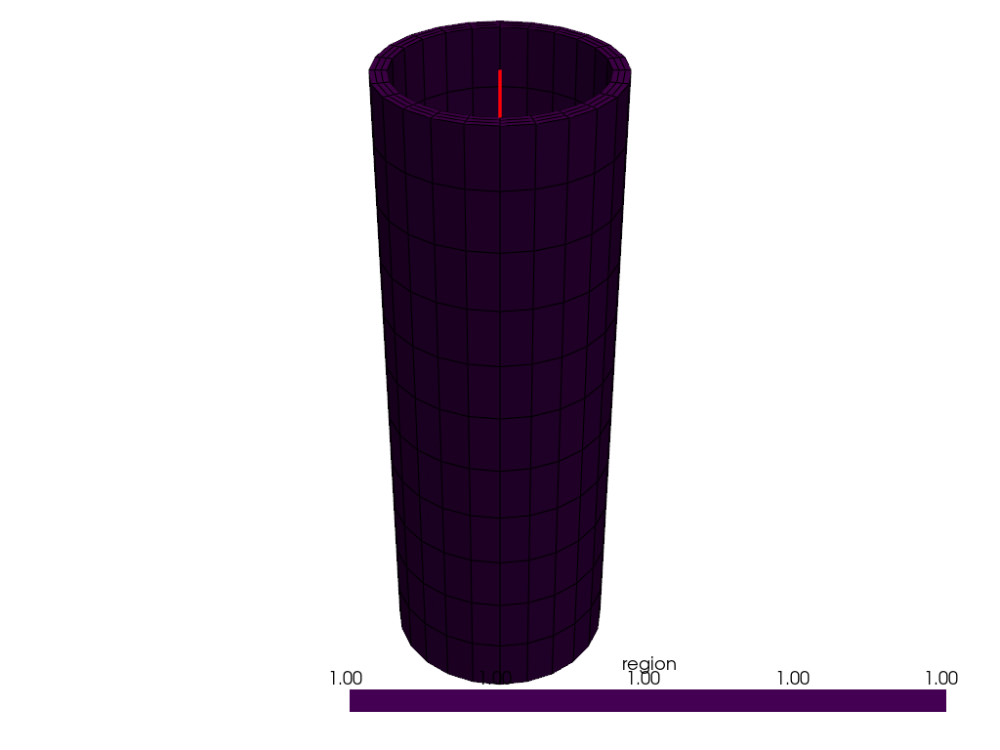
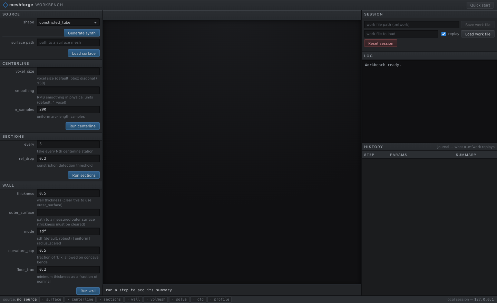
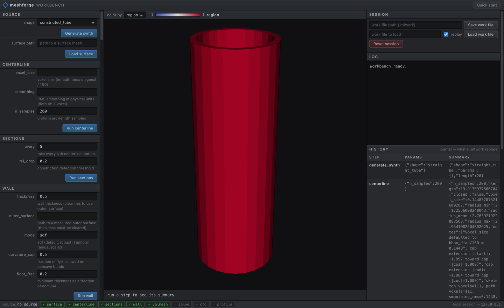

# meshforge — first-run tutorial

New here? This walks you from a cold install to your **first mesh**, a **solve**,
and **saving/replaying** your work — start to finish in a few minutes, driving the
**Workbench** (the web/desktop UI). It is the friendly path; for the exhaustive
per-control reference see **[APP_GUIDE.md](APP_GUIDE.md)**.

Every command and click below was run against the real app; the outputs are
pasted verbatim.

---

## What you'll build

A watertight straight-tube surface → its centerline → a wall → a hex volume mesh
(0 inverted cells) → a CalculiX stress solve → a saved, replayable work file. The
same pipeline handles CAD profiles, 3-D CAD solids, and medical image volumes; the
tube is just the quickest way to see the whole loop.



---

## 1. Before you start

meshforge runs in the conda env `meshforge`. From a terminal:

```bash
cd /path/to/meshforge     # quote the path if it contains spaces
conda activate meshforge
meshforge --help          # sanity check: prints the subcommands
```

Everything you generate lands under `outputs/` **relative to where you launched**,
so always start from the project folder. Solvers (CalculiX, OpenFOAM, MYSTRAN) are
auto-discovered — nothing to configure for this tutorial.

---

## 2. Launch the Workbench

Two ways to open the **same** UI:

```bash
meshforge web        # opens in your browser
# meshforge web -> http://127.0.0.1:PORT  (127.0.0.1 only; Ctrl-C to stop)
#   Workbench: http://127.0.0.1:PORT/app/   OpenAPI docs: .../docs   schema: .../schema
```

Open the printed **`/app/`** URL. Or, for a native desktop window:

```bash
meshforge desktop    # same Workbench inside an app window
```

The app is **local-only** (binds `127.0.0.1`, makes no external requests). Prefer
the terminal? Every step below has a `meshforge …` CLI twin.

> `meshforge-gui` still works too — it's now an alias that opens the desktop window.

---

## 3. The Workbench at a glance



Three panes:

- **Left — steps.** A **source** box (pick a synthetic **shape** and
  **Generate synth**, or type a **surface path** and **Load surface**), then one
  panel per pipeline step. Each panel has its knobs and a **Run …** button. There's
  no file dialog — paths are typed.
- **Centre — the 3-D viewport.** Renders whatever the last step produced; orbit
  with the mouse, recolor with **color by**, and scrub CFD time series with the
  play/slider. A **summary** line sits underneath.
- **Right — log, history, work files.** The **log** echoes each step, the
  **history** table is the journal (exactly what a `.mfwork` file replays), and
  **Save / Load work file** + **Reset session** live at the top.

The top bar shows the session **state**: the input and a chip per artifact
(`surface`, `centerline`, `wall`, `volmesh`, `solve`, …) that lights up as you go.

Steps have **prerequisites** — running one before its input exists fails *loudly*
in the log (e.g. *"no centerline available — run compute_centerline first"*).
Nothing breaks; just run the missing step. So: **top to bottom.**

---

## 4. Your first mesh (the happy path)

Do these in order. Each row is a click in the Workbench and its CLI twin.

| # | In the Workbench | CLI twin |
|---|---|---|
| 1 | **source:** shape `straight_tube` → **Generate synth** | `meshforge synth straight_tube` |
| 2 | **Run centerline** | *(session step)* |
| 3 | **Run sections** *(optional)* | *(session step)* |
| 4 | **wall:** `thickness 0.5` → **Run wall** | *(session step)* |
| 5 | **volmesh:** `n_theta 24`, `n_axial 12`, `n_layers 3` → **Run volmesh** | `meshforge volmesh outputs/straight_tube.vtp --thickness 0.5 --n-theta 24 --n-axial 12 --n-layers 3` |

The log fills in as you go (verbatim):

```
synth straight_tube: 2626 pts, 5248 tris, length 20, closed False
centerline: 200 samples, length 19.9131, radius 2.173..2.954, closed False
sections: 40 planes, area 28.2289..28.2289; constrictions: 0
wall: thickness 0.4943..0.5018, capped 0, floored 0
volmesh[swept]: 792 cells, inverted 0, sj_min 0.9886, volume 200.833
  boundary: {'inner': 264, 'outer': 264, 'inlet': 72, 'outlet': 72}
```

**Read the volmesh line — it's the quality gate.** `inverted 0` is mandatory (a
non-zero count means a tangled mesh; coarsen or adjust knobs until it's 0).
`sj_min` (scaled Jacobian, here 0.9886) is the quality floor — closer to 1 is
better. The **boundary** groups (`inner / outer / inlet / outlet`) are the names
your loads and BCs will reference next.

The viewport now shows the tube — orbit it, and try **color by** to shade it by a
field:



---

## 5. Solve it (FEA)

Pressurise the inner wall and clamp both ends. In the **solve** panel set:

- `analysis` = `static`
- `E` = `1000`, `nu` = `0.3`
- `fix` = `inlet:1-3,outlet:1-3`  *(clamp DOFs 1–3 at both ends)*
- `pressure` = `inner=1.0`

→ **Run solve**:

```
solve[ccx]: 1152 nodes, fields DISP, ERROR, STRESS, TOSTRAIN, 0.1s
  |U| max     : 0.0201864
  von Mises max: 6.85924
  results attached to the session volmesh point data
```

The results attach to the mesh, so **color by** `U_mag` or `S_mises` paints the
stress/displacement field right in the viewport.

CLI twin (build a deck, then run it):

```bash
meshforge deck outputs/straight_tube.vtp --thickness 0.5 --n-theta 24 --n-axial 12 \
    --n-layers 3 --material elastic --E 1000 --nu 0.3 \
    --fix inlet,1,2,3 --fix outlet,1,2,3 --pressure inner,1.0 --target ccx --out outputs/tube
meshforge solve outputs/tube.inp
```

Prefer flow? The **cfd** panel runs OpenFOAM instead — see
[APP_GUIDE §3.10](APP_GUIDE.md#310-cfd).

---

## 6. Save & replay your work

Your **history** table is the journal. To capture it:

1. Type a path in **work file path** (e.g. `outputs/tube.mfwork`) → **Save work file**.
2. **Reset session** (clears everything).
3. Put the same path in **work file to load**, keep **replay** ticked → **Load work file**.

The whole pipeline re-runs from the recorded knobs and the history reappears — a
`.mfwork` is a compact, exact recipe of your session. CLI twin:

```bash
meshforge replay outputs/tube.mfwork          # optionally: --set volmesh.n_theta=48
```

`--set STEP.KNOB=VALUE` re-runs only from the changed step onward — handy for
parameter tweaks without redoing the whole thing.

---

## 7. Export a figure (headless)

The **screenshot** panel renders the current scene to a PNG in `outputs/` — no
display needed, so it works over SSH or in a script (it's how the tube figure at
the top of this page was made):

```
screenshot (volmesh, centerline) -> outputs/session.png
```

---

## 8. Where to go next

- **[APP_GUIDE.md](APP_GUIDE.md)** — the full reference: every step's knobs
  (§3), the CLI table (§6), recipes/batch sweeps (§7), where files land (§8), the
  troubleshooting table (§9), and honest limits (§10).
- Try a different `shape` (`curved_tube`, `tapered_tube`, `constricted_tube`,
  `torus`, or primitives like `box`/`solid_cylinder`), or load your own surface.
- Drive a real CAD drawing: [APP_GUIDE §5](APP_GUIDE.md#5-the-dwg-path-cottage_pane_windowdwg).

> **How the images here were made** (reproducible). The mesh figure is the
> `screenshot` step. The Workbench shots are 1440×880 captures of `meshforge web`
> running on `127.0.0.1`. Doc images live in `docs/images/` (git-tracked);
> generated artifacts always go to git-ignored `outputs/`.
>
> To retake them, start the server on a fixed port and drive the session to the
> state you want to photograph:
>
> ```bash
> meshforge-web --port 8731 &
> B=http://127.0.0.1:8731
> # workbench_overview.png — the empty Workbench
> curl -sX POST $B/session/reset -H 'Content-Type: application/json' -d '{}'
> # workbench_meshed.png — the §4 happy path, exactly as quoted above
> curl -sX POST $B/source/synth   -H 'Content-Type: application/json' -d '{"shape":"straight_tube"}'
> curl -sX POST $B/step/centerline -H 'Content-Type: application/json' -d '{}'
> curl -sX POST $B/step/sections   -H 'Content-Type: application/json' -d '{}'
> curl -sX POST $B/step/wall       -H 'Content-Type: application/json' -d '{"thickness":0.5}'
> curl -sX POST $B/step/volmesh    -H 'Content-Type: application/json' \
>      -d '{"n_theta":24,"n_axial":12,"n_layers":3}'
> ```
>
> Then open `http://127.0.0.1:8731/app/` in a **real browser window** sized to
> 1440×880 and capture it (macOS: `Cmd-Shift-4`, then Space, then click the
> window). Headless capture works for the *empty* Workbench —
>
> ```bash
> chrome --headless=new --window-size=1440,880 --hide-scrollbars \
>        --force-device-scale-factor=1 --virtual-time-budget=8000 \
>        --screenshot=docs/images/workbench_overview.png http://127.0.0.1:8731/app/
> ```
>
> — but **not** for any shot containing the 3-D viewport: headless Chrome does
> not composite the vtk.js WebGL canvas, so the viewport comes out empty.
